# Subagent Monitor

A Claude Code mod that shows your running subagents in a live side panel. Every agent gets its own animated creature, and the panel shows what each agent is doing right now, which model and effort it runs on, how many tokens and tools it has used, and how long it has been running.

<p align="center">
  
</p>

<p align="center">
  
</p>

<p align="center"><sub>The panel picture is an illustration. The creatures are drawn by the mod's own generator and animate here too.</sub></p>

---

## Contents

- [Features](#features)
- [Requirements](#requirements)
- [Install](#install)
- [Usage](#usage)
- [What the panel shows](#what-the-panel-shows)
- [Statuses and colors](#statuses-and-colors)
- [Creatures](#creatures)
- [Responsive layout](#responsive-layout)
- [Terminal and graphical surfaces](#terminal-and-graphical-surfaces)
- [Notifications](#notifications)
- [How it works](#how-it-works)
- [Customize](#customize)
- [Development](#development)
- [Troubleshooting](#troubleshooting)
- [Limitations](#limitations)
- [License](#license)

## Features

- **Live side panel** that opens by itself when the first subagent starts.
- **A unique animated creature per agent.** Its shape, color, head decoration, spots and cheeks come from the agent's id, so an agent always looks the same. The creature reacts to the agent's state: it bobs and looks around while running, breathes while waiting, hops with a sparkle when done, and shakes and turns gray when it fails.
- **Live activity line.** It shows the tool the agent is using right now, for example `↳ Grep · router` or `↳ Read · session.ts`.
- **Model and effort** for every agent, with effort drawn as a five-step bar (`▰▰▰▱▱ high`).
- **Tokens, tool count and elapsed time** per agent, plus totals for the whole session.
- **Activity sparkline** of the tool calls made by subagents over the last minutes.
- **Nested agents.** An agent that another agent spawned is listed right after its parent.
- **Click an agent's name for more.** In the desktop app, VS Code and mobile the card opens in place and shows the full task, the full model id, the start time, the last tool and the start of the agent's answer. In the terminal the click opens the agent's whole transcript.
- **Finish notifications.** A toast appears when an agent finishes, fails or is stopped. Agents that finish together share one toast.
- **Responsive.** The layout adapts to the pane's width, from compact rows to a grid of up to three columns.
- **Works on every surface**: SVG creatures in the desktop app, VS Code and mobile, and colored text faces in the terminal.

## Requirements

- Claude Code with mod (function hook) support. The mod was built and tested on **Claude Code 2.1.309**.
- The mods API is early access and may change between Claude Code releases. If the panel stops working after an update, check [Troubleshooting](#troubleshooting).

## Install

This repository is a plugin marketplace with one plugin in it, so you can install it straight from GitHub.

**In a Claude Code terminal session**, type at the prompt:

```
/plugin install subagent-monitor --marketplace blogchik/subagent-monitor
```

Claude Code asks `Add marketplace?` for `github:blogchik/subagent-monitor`. Answer `y`, then choose a scope (the user scope is first and makes the mod load in every session). You'll see `Installed subagent-monitor. Plugin is now active.` and the mod runs right away.

**From a shell:**

```bash
claude plugin install subagent-monitor --marketplace blogchik/subagent-monitor
```

**In the Claude desktop app**, where `/plugin` isn't available: click **+** next to the prompt box, then **Plugins**, **Add marketplace** with `blogchik/subagent-monitor`, then **Add plugin**.

A mod installed from a terminal at the user scope also loads in the desktop app's local sessions.

### Update or remove

```bash
claude plugin update subagent-monitor
claude plugin uninstall subagent-monitor
```

Run `/reload-plugins` in an open session to pick up an update without restarting.

## Usage

There is nothing to configure.

1. Start any work that spawns subagents, for example "explore this repo with two agents in parallel".
2. The **Subagents** panel opens by itself when the first agent starts.
3. Watch the cards update: the timer ticks, the activity line follows each tool call, and the tokens and tool count grow.
4. **Click an agent's name** for more:
   - In the **desktop app, VS Code and mobile** (`Explore ▸`), the card opens in place (`▾`) and shows the full task, the full model id, the start time with the tool count, the last tool, the agent id and, once the agent is done, the start of its answer. Click again to close it.
   - In the **terminal** (`Explore ↗`), the agent's transcript opens in the main view and the card is marked with `◀`. Click it again, or press **← Back to main chat**, to return.
5. When an agent finishes, its card turns purple and a toast tells you how long it took and how many tokens it used.

| Action | Result |
| --- | --- |
| First subagent starts | The panel opens by itself |
| You close the panel | It stays closed for the rest of the session, even when new agents start |
| `/subagents` | Opens the panel again and turns automatic opening back on |
| `/clear` | Empties the agent list and the activity sparkline |

The panel keeps the 50 most recent agents. When there are more, the oldest finished agents are dropped first. Active agents are never dropped.

## What the panel shows

### Header

```
● 2 active   ✓ 3   ✗ 1                 Σ 214.3k tok · 47 tools
▁▂▁▃▅▂▁▃▆▄▂▅▇▅▃▆█   activity · 5 min
```

- **Active count** in blue, **done count** in purple, **failed or stopped count** in red (shown only when there is one).
- **Σ**: the tokens and tool calls of all listed agents together.
- **Activity sparkline**: subagent tool calls in 10-second buckets. The last bar, the current bucket, is blue. It shows up after the first tool call. It keeps 10 to 30 buckets depending on the pane width.

### Agent card

```
╭──────────────────────────────────────────────────────╮
│  (creature)  Explore ↗                       ● 0:42  │
│              Find the API endpoints                  │
│              ↳ Grep · router                         │
│              haiku-5-5 · ▰▰▰▱▱ high · 41.2k tok · 6 tools │
╰──────────────────────────────────────────────────────╯
```

| Line | Content |
| --- | --- |
| 1 | The agent type (`Explore`, `Plan`, `general-purpose`, a plugin's agent), clickable (see [Usage](#usage)), and the status mark with the elapsed time on the right |
| 2 | The short task description the Agent call was given |
| 3 | While active: the latest tool call, blue while that tool is still running. Once finished: how it ended (`✓ done`, `✗ failed`, `■ stopped`) |
| 4 | Model, effort, tokens and tool count |

**Activity line.** The detail next to the tool name is picked from the call's arguments in this order: the file name (`file_path`, `notebook_path`), `pattern`, `command`, `query`, the host of `url`, `description`, the last part of `path`, `skill`. MCP tools are shown without their `mcp__server__` prefix. Long details are cut with `…`.

**Effort** is drawn as a five-step bar: `low` ▰▱▱▱▱, `medium` ▰▰▱▱▱, `high` ▰▰▰▱▱, `xhigh` ▰▰▰▰▱, `max` ▰▰▰▰▰. A numeric effort is shown as `effort N`.

**Tokens** are the context size of the agent's latest model request: input + cache read + cache creation + output. This is the same number Claude Code shows as "tokens" in an Agent result. In live tests the two matched exactly.

**Model** names are shortened: `claude-haiku-5-5` is shown as `haiku-5-5`. The opened details show the full id.

**Details** (desktop app, VS Code and mobile) add these lines under an opened card:

```
Model      claude-haiku-5-5
Started    14:42:05 · 6 tools
Last tool  Grep · router
Agent id   a3f9c2e81b7d04c56
Answer
Found 12 endpoints under src/routes …
```

The answer keeps the first 600 characters of the agent's final answer.

## Statuses and colors

| Status | Mark | Color | Card |
| --- | --- | --- | --- |
| running | `●` (a spinner in the terminal) | blue `#378ADD` | blue border |
| pending, waiting | `○`, `◐` | light blue `#85B7EB` | light blue border |
| done | `✓` | purple `#7F77DD` | dimmed purple border |
| failed | `✗` | your theme's error color | dimmed red border |
| stopped | `■` | your theme's warning color | dimmed border |
| idle (teammates between turns) | `◌` | dimmed | dimmed border |

In the terminal, the card whose transcript you're viewing is outlined in pink (`#D4537E`). Cards highlight blue on hover.

## Creatures

Every creature is generated from the agent's id with a seeded random generator, so the same agent always gets the same creature. The generator picks:

- one of 7 color palettes,
- one of 3 body shapes (round, tall, ghost),
- one of 5 head decorations (none, antennae, horns, ears, a leaf sprout),
- 0 to 3 spots, and whether it has cheeks.

| Mood | When | Animation |
| --- | --- | --- |
| running | the agent is working | pops in, bobs, blinks, looks left and right |
| waiting | pending or waiting | breathes slowly, three dots pulse above it |
| done | finished with an answer | happy eyes, hops twice, a purple sparkle twinkles |
| failed | ended with an error | turns gray, × eyes, shakes its head |
| stopped | interrupted | turns gray, eyes closed |
| idle | a teammate between turns | eyes closed, a "z" floats up |

A creature animates while its agent is active or idle and for 15 seconds after it finishes. After that it becomes a still picture, so a long list of finished agents stays light.

## Responsive layout

The panel reads its width in cells and picks a layout:

| Pane width | Layout |
| --- | --- |
| under 36 cells | **Compact rows**: a small creature, the name, the time, and one line of activity or status |
| 36 to 55 | **Snug cards**: a smaller creature, and the meta line split into two (model and effort, then tokens and tools) |
| 56 to 95 | **Regular cards**: one meta line |
| 96 and wider | **Grid**: one card column per 48 cells, up to 3 columns |

The header stacks into two lines below 56 cells. On graphical surfaces the spacing uses the surface's own spacing steps. In the terminal it uses whole cells, and the card borders separate the cards.

## Terminal and graphical surfaces

| | Desktop app, VS Code, mobile | Terminal |
| --- | --- | --- |
| Creature | Animated SVG | A colored kaomoji face in the agent's color, for example `(•‿•)`, which blinks every few seconds |
| Running mark | `●` | A braille spinner `⠋⠙⠹⠸…` |
| Sparkline | SVG bars | Block characters `▁▂▃▅▇` |
| Click an agent's name | Opens the card's details in place (`▸` / `▾`) | Opens the agent's transcript (`↗`, then `◀`) |
| Hover | Card border highlight | Where the terminal reports the pointer |

The difference in clicks comes from Claude Code itself: the desktop app, VS Code and mobile run Claude Code in the background and draw the chat themselves, so there is no main view the mod could switch to an agent's transcript. Only the terminal has one.

## Notifications

When an agent finishes, a toast appears for 8 seconds:

```
✓ Explore finished · 1:15 · 72.8k tok — Find the API endpoints
```

- Agents that finish at the same moment share one toast: `2 subagents finished: ✓ Explore 0:26, ✓ Plan 0:31`.
- Each agent gets one toast, never two, even when both the end of its turn and the agent list report it.
- Teammates and workflow agents raise no toasts, so a busy team or a workflow with many agents doesn't flood the screen. They still show in the panel.
- After a reload of the mod, agents that had already finished don't raise a toast again.

## How it works

Subagent Monitor is a single hooks module (`hooks/register.tsx`) plus a creature generator (`hooks/creature.ts`). It uses these parts of the Claude Code mods API:

| Source | What it gives the panel |
| --- | --- |
| `agent.spawn` | A new agent: id, type, description, model, parent, start time |
| `tool.call` (with `agentId`) | The activity line, the tool count and the sparkline |
| `turn.step` (with `agentId`) | Tokens of every model request, the model and the effort |
| `turn.complete` (with `agentId`) | How the agent ended (answer, interrupted, error) and the start of its answer. This triggers the toast |
| `$.agent.list()` | The true status of every agent, read once a second while any agent is active. It also picks up agents that started before the mod loaded |
| `$.ui.open` and a `Pane` render hook | The panel itself |
| `$.ui.view({ agentId })` | Opens an agent's transcript when you click its card (terminal only) |
| `$.ui.toast` | Finish notifications |
| `$.state` | The agent list, the sparkline, the opened cards and the closed-by-you flag. They survive a reload of the mod within a session |

The hooks on spawns, tool calls, model requests and turn ends pass the event on unchanged. The mod only observes them, so it never blocks or changes a tool call, a model request or an agent. Hooks that touch tool calls and spawns carry a `.catch` that simply continues, so a fault in the mod can't stop your agents.

The 1-second timer only does work while at least one agent is active, so an idle session costs nothing.

## Customize

The tunable values are constants at the top of [`hooks/register.tsx`](hooks/register.tsx):

| Constant | Default | Meaning |
| --- | --- | --- |
| `ACTIVE`, `ACTIVE_SOFT`, `DONE`, `VIEWED` | `#378ADD`, `#85B7EB`, `#7F77DD`, `#D4537E` | Panel colors |
| `MAX_ROWS` | `50` | Agents kept in the list |
| `TOAST_MS` | `8000` | How long a finish toast stays |
| `FRESH_MS` | `15000` | How long a finished creature keeps animating |
| `ANSWER_KEEP` | `600` | Characters of an agent's answer kept for its details |
| `SPARK_BUCKET_MS` | `10000` | Sparkline bucket size |
| `SNUG_FROM`, `REGULAR_FROM`, `GRID_FROM`, `GRID_CELL` | `36`, `56`, `96`, `48` | Layout breakpoints, in cells |

The creature palettes, shapes and animations are in [`hooks/creature.ts`](hooks/creature.ts).

To use your own version, fork the repository, change the constants, and install from your fork (`--marketplace <you>/subagent-monitor`), or run it from a local folder as shown below.

## Development

```
subagent-monitor/
├── .claude-plugin/
│   ├── plugin.json          the plugin manifest
│   └── marketplace.json     makes this repository installable as a marketplace
├── hooks/
│   ├── hooks.json           names the hooks module
│   ├── register.tsx         events, state and the panel
│   └── creature.ts          the creature generator (SVG and terminal faces)
├── types/
│   └── index.d.ts           the $.state contract
├── tests/
│   └── subagents.test.tsx   tests run by `claude plugin test`
├── assets/                  README pictures
└── tsconfig.json
```

**Run from a local clone.** Start Claude Code with the folder as a plugin directory. An interactive session watches the folder and reloads the mod when you save a file:

```bash
git clone https://github.com/blogchik/subagent-monitor.git
claude --plugin-dir ./subagent-monitor
```

In the desktop app, add the folder's absolute path to `CLAUDE_CODE_PLUGIN_DIRS` in the `env` block of `~/.claude/settings.json` instead.

**Check, type-check and test:**

```bash
claude plugin validate ./subagent-monitor
claude plugin test ./subagent-monitor
```

When Claude Code loads the mod from a folder it watches, it writes the API's type declarations into `.claude-plugin/types/` (git-ignored). The top-level `tsconfig.json` extends them, so after one run with `--plugin-dir`, `tsc -p ./subagent-monitor` type-checks the mod.

Use a `claude` binary at least as new as the Claude Code you run the mod in. An older CLI may not know newer events and fail the tests with errors such as `"ui.view" is not an event`.

## Troubleshooting

**The panel doesn't open.** Type `/subagents`. If you closed the panel earlier, it doesn't open by itself again until you do. On a narrow terminal, a pane opened by a plugin may wait until the window is wide enough; `/subagents` tells you why.

**Clicking a card doesn't open the transcript in the desktop app.** That's expected: only the terminal has a main view the mod can switch, so on the desktop app, VS Code and mobile a click opens the card's details instead. To read the full transcript there, use the app's own agent view.

**"Couldn't open the transcript: …" in the terminal.** Claude Code opens an agent's transcript only from a click, and only for agents its tasks list shows. A teammate that runs in its own terminal pane can't be opened from the panel.

**Two panels or double toasts.** The mod is loaded twice, for example once installed and once from a `--plugin-dir` folder. Remove one of them.

**No tokens, model or effort on a card.** These arrive with the agent's first model response, a few seconds after it starts. Agents that started before the mod loaded show their tokens from their next request on.

**A hook failed after a Claude Code update.** The mods API is early access. Run `claude plugin validate` on the folder to see what the new version refuses, and open an issue with its output.

## Limitations

- Workflow agents that run remotely send no local events, so they don't appear.
- The panel has no button to stop an agent.
- Teammates switch to `idle` between turns and raise no toasts.
- The agent list belongs to the session: a new session starts with an empty panel.
- Where the panel sits (docked beside the transcript or above the prompt) and how wide it is are decided by the surface.

## License

[MIT](LICENSE)
